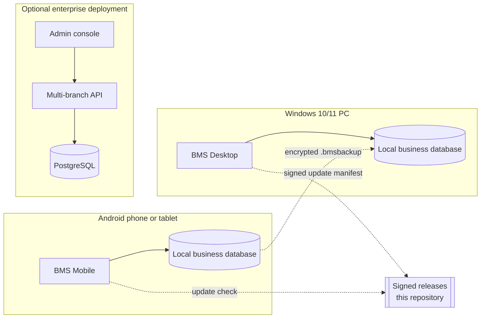

# How BMS is built

A plain-language tour for buyers, IT reviewers and anyone who wants to know what
runs inside BMS before trusting it with the books. This is the overview, not the
engineering specification.

## The short version

BMS is a local-first business system. The Android and Windows apps each keep a
complete copy of the business on the device, using an embedded database. There is
no central account and no mandatory server. A sale, a purchase, a stock count or
a report works at full speed with the network off.

That choice drives everything else: the data model, the backup format, the way
the two apps stay compatible and the way updates are delivered.

## At a glance

The two offline apps are complete products on their own. The enterprise stack is
a separate, server-based edition for organisations that need many users,
branches and a central database.

## Design principles

**Offline is the normal case, not a failure mode.** The device database is the
primary store. Network features — update checks, map links — are optional and
never block a sale.

**One business model, two form factors.** The phone and the PC implement the same
rules for stock, credit, costing and the ledger. A backup taken on one restores
on the other, with the same reports.

**The books must reconcile.** Sales, purchases, payments, expenses and salaries
produce balanced double-entry postings in the same transaction as the business
record. There is no nightly job that can leave the ledger behind.

**Upgrades never destroy history.** Schema changes are additive and automatic.
Older databases are upgraded in place; there is no "start again" migration.

**Updates are signed and visible.** The user decides when to install. The update
channel carries a cryptographic signature that the app checks before running new
code.

## The offline core

Each installation owns a single embedded database file. It stores the catalogue,
customers and suppliers, sales and purchases, stock lots, the chart of accounts
and journal, expenses, employees and route plans. The database engine provides
transactions and foreign-key integrity, so a half-finished sale cannot be saved.

The two apps use the same logical schema and the same identifier and date
conventions. That is what makes the encrypted backup portable: the file describes
business data, not a particular operating system.

Business logic runs on the device. Reports are calculated locally from the same
records that were written locally, so there is no waiting for a server and no
question about which copy is authoritative.

## The two clients

| | BMS Mobile | BMS Desktop |
|---|---|---|
| Built with | Flutter (Dart) | Tauri 2 (Rust backend, WebView front end) |
| Best for | Counter, field sales, deliveries | Back office, purchasing, reporting |
| Data | Local database on the device | Local database in the Windows user profile |
| Updates | In-app download, Android installer confirmation | Signed manifest, verified installer, restart |

Both clients share the same module set: dashboard, sale counter, inventory,
customers and credit, purchases, routes, reports, expenses, employees,
manufacturing and profit-and-loss. The business can hide modules it does not use
during setup or later in Settings.

## The accounting and inventory engine

A few ideas do most of the work:

- **Double-entry ledger.** Every money event is a debit and a credit. Bank,
  cash, receivables, revenue, expenses and salaries stay consistent by
  construction.
- **Cost at the time of sale.** Each sale line stores the cost that applied when
  it was sold. Later price changes do not rewrite history, so profit reports
  remain stable.
- **Lots and FIFO.** Received stock is tracked in lots with their own cost.
  Sales consume the oldest lot first, which matches how a real warehouse and a
  real margin behave.
- **Pack units.** A bottle, carton or dozen is a way to buy and sell; stock,
  costing and batches remain in the base unit, so the count never becomes
  ambiguous.
- **Recipes with a batch yield.** A business that makes its own goods describes
  one batch and what it produces. BMS derives the ingredient cost per unit sold
  and consumes the ingredients when the sale is confirmed.
- **Snapshot fields.** Customer names, item names and costs are copied onto
  documents so an old invoice still reads the way it did when it was issued.

## Data protection

- **Local by default.** Business records are not uploaded. There is no account,
  analytics or crash-reporting service.
- **Operating-system isolation.** The database sits in the app's private storage
  on Android and in the user profile on Windows. Android cloud backup of the app
  data is disabled.
- **Encrypted transfer.** `.bmsbackup` files are compressed and encrypted with
  AES-256 using a key derived from the operator's passphrase. The file header and
  contents are authenticated, so tampering is detected.
- **App Lock.** An optional gate uses the device's own biometric or screen-lock
  authentication.
- **Plaintext exports are labelled.** Excel workbooks are readable by anyone who
  has the file; the app warns before writing one.
- **Device security still matters.** The working database itself relies on the
  operating system's protection. Use a device lock and full-disk encryption.

## Updates and supply chain

Releases are built from a private source repository and published here as signed
assets. The desktop app reads a small update manifest that points at a specific
installer and carries its signature; the app verifies that signature before
installing and then restarts. The Android app downloads the APK and hands it to
the system installer, which only accepts an update signed by the same app
identity. Every published binary has a SHA-256 checksum for manual verification.

## The enterprise edition

Organisations that need multiple users, branches and a shared database can run
the BMS enterprise edition: a .NET API over PostgreSQL with role-based access,
company-level data isolation, an audit trail and a Flutter administration
console. It is a separate product with its own deployment and release line; the
offline apps do not depend on it and do not call it.

## What BMS deliberately does not do

- **No silent cloud sync.** Two devices exchange data through an encrypted backup
  that the operator controls. There is no background replication to reconcile.
- **No remote kill switch.** The app keeps working if this repository is
  unreachable.
- **No data mining.** There is no telemetry pipeline to switch off.
- **No forced upgrades.** Updates are offered, not imposed.

These are trade-offs, not gaps: they keep the product predictable, private and
usable in shops where connectivity is unreliable.

## Quality

Both clients have automated suites covering setup, sales, purchasing, stock,
credit, recipes, reporting, backup and restore; the enterprise API has
integration tests for authentication, authorization, tenancy and the sale
workflow. A release is only published after the Android app, the Windows
installers and their update signatures have been built and verified together.

## Questions

- **Does it need the internet?** No. Only updates and map links use it.
- **Can two devices share one business?** Yes, by moving an encrypted backup.
  There is no live multi-device sync in the offline edition.
- **Where is my data?** On the device, in the app's database file, plus any
  backups you export.
- **What if I lose the device?** Restore your latest `.bmsbackup` on a new one.
  Keep backups somewhere safe and remember the passphrase — it cannot be reset.
- **Can I try it without committing?** Yes. Setup creates a blank business; you
  can remove the app and its data at any time.

For installation links, see the [README](README.md). For security reports, use
the repository's private security advisory rather than a public issue.
